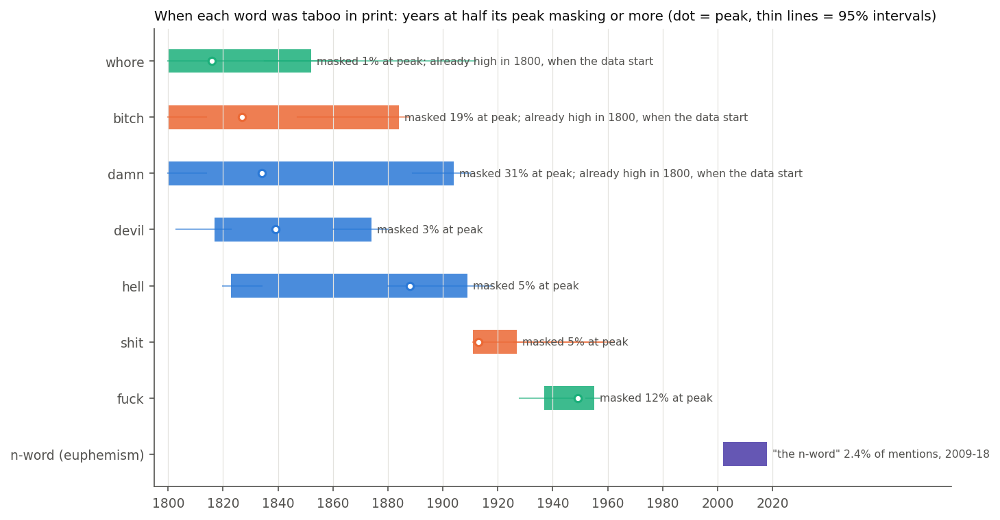
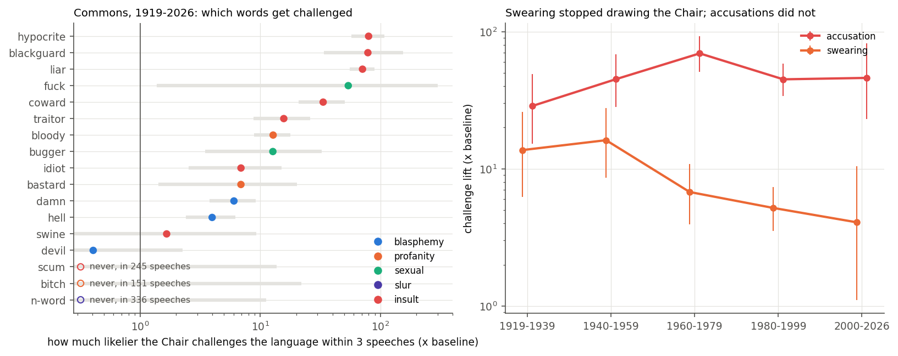
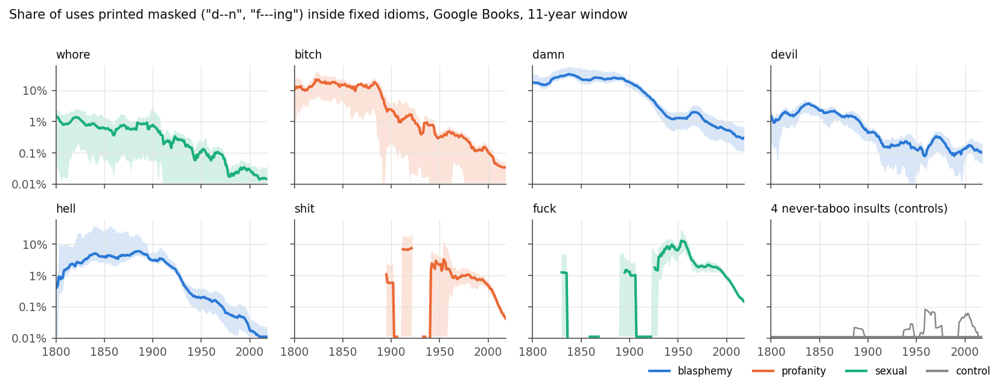
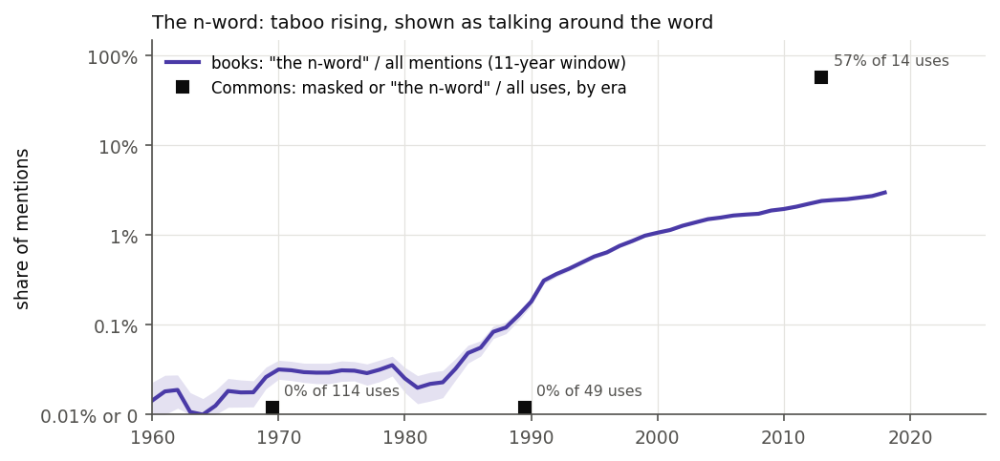

# When did words become swears?

How did words move between "offensive" and "neutral" over time? Two records are used. In
books, a word is taboo when printers would not set it in full: "be d--d", "what the f---".
Inside fixed idioms (where "d--d" can only be "damned"), the share of uses printed masked is a
taboo index, measured from 1800 to 2018 in Google Books Ngrams. In the House of Commons
(Hansard, 1919 to 2026, 15,531 sitting days, 983 million words), the index is how much likelier
the Chair is to step in ("I must ask the hon. Member to withdraw that word") after a speech that
uses the word, and whether the official report prints it in full.

**Headline: taboo moved from religion to the body to race, and each wave of masking collapsed,
by 28 to 560 times from its peak.**

* **Blasphemy came first.** "damn" was printed masked in 31% of idiomatic uses at its peak
  (1834, 95% CI 1832 to 1843), "hell" in 5% (1888), "devil" in 3% (1839). All three were at half
  their peak or more for most of the 19th century and fell away between 1870 and 1910. Today
  "damn" is masked 0.3% of the time, 96 times less.
* **Sex and the body came next.** "shit" peaked in the 1910s (5%) and "fuck" in 1949 (12%, CI
  1934 to 1952), then fell 50 to 70 times.
* **Race came last, and it is not masked, it is talked around.** Dash masking of the n-word
  never rose in books. What rose was "the n-word": from 0.01% of mentions in 1960 to 1% in 2000
  and 2.4% in 2013. In the Commons the word was said in full 315 times between 1919 and 1979,
  two-thirds of the time in the idiom "the n-word in the woodpile", with no challenge from the
Chair. Since
  2000, 8 of its 14 appearances have been "the n-word".

The ordering (every datable blasphemy peak before every datable bodily or sexual peak) holds in
all 11 variants of the analysis, and so does a tenfold fall from peak for every word.



In Parliament the picture is different, because the Chair polices accusations, not vocabulary.
Calling someone a hypocrite (80 times baseline), a blackguard (79) or a liar (71) is what gets a
Member stopped. Swearing draws the Chair far less (bloody 13, damn 6, hell 4) and less every
decade: the pooled swearing lift fell from 14 and 16 times baseline before 1960 to 5 in the
1980s and 90s and 4 since 2000, while accusations stayed between 29 and 69.



## Running it

```bash
pip install -r requirements.txt
```

```bash
python fetch_ngrams.py && python fetch_hansard.py
```

```bash
python ngram_index.py && python sensitivity.py
```

```bash
python extract_hansard.py && python hansard_index.py && python sample_check.py
```

```bash
python figures.py && python report.py > out/summary.md
```

```bash
python -m pytest
```

`fetch_ngrams.py` makes about 200 requests to the Ngram API and caches every response, so a rerun
costs nothing. `fetch_hansard.py` downloads 15,531 XML files from TheyWorkForYou (1.9 GB once
reduced to text) and skips days it already has; on a slow connection a second copy can run with
`--reverse`. Extraction takes about 20 minutes on 16 cores. `report.py` prints every number quoted
here. The tests need none of the data.

## What the pieces do

| file | role |
|---|---|
| `words.py` | every modelling choice about words: the idioms each word is counted in, how masks are built, which masks are too ambiguous to use, the Hansard word list, how a masked token like "b*****d" is matched to a word |
| `fetch_ngrams.py` | queries every idiom in full and masked forms, plus "the n-word", and the corpus's yearly word totals |
| `ngram_index.py` | masking rate per word and year, spike capping, bootstrap intervals, peak and span dating |
| `sensitivity.py` | reruns the book analysis eleven ways, changing one choice each time |
| `fetch_hansard.py` | downloads Commons debates and reduces each day to one line per speech |
| `extract_hansard.py` | one pass over every speech: full words, masked words, "the n-word", and Chair challenges |
| `hansard_index.py` | uses per million words, masked share, and challenge lift by word and era |
| `sample_check.py` | draws a stable sample of Hansard hits for checking by hand |
| `figures.py`, `report.py` | the four figures, and every number in this README |

## Method

### Books: masking inside idioms

A bare "d-n" or "s-t" in Google Books is mostly notation (chemistry, circuits, chess). Inside an
idiom it is not: "be d--d", "God d--n", "what the h--l", "son of a b--h". Each word gets four to
eight idioms. Every idiom is queried in full and with masks built from the word's first and last
letters and one to four dashes ("d-n", "d--n", "d---n", "d----n"), plus masks seen in print
("bl--dy", "b-gg-r", "d--n'd"). Both the idiom as written and its sentence-initial capitalised form
are counted.

Google folds em dashes into hyphens, so a Victorian "d", em dash, "d" and a modern "d-d" are
the same n-gram. That is why the
idioms matter: a single hyphen between two letters is ordinary notation after "the" or "a" ("the
n-s transition", "the s-l curve"). In idioms made only of a determiner and the word, single-hyphen
masks are dropped. A mask with no last letter ("be d--") is used only in idioms that point to one
word: "you b---" could be bastard, bitch, bloody or bugger, so it is not counted for any of them.

The rate for a word and year is masked over masked plus full, pooled over its idioms and an
11-year window (21 years for dating). Frequencies become approximate counts through the corpus's
yearly word totals. A window needs 100 occurrences before it gets a rate, and a word needs 500
masked occurrences overall before its peak is dated. Intervals come from 1,000 bootstrap draws
that resample the word's idioms and redraw every count from a Poisson.

**Controls.** Four insults that were never taboo (rascal, scoundrel, villain, fool) go through
the same pipeline. Their highest masking rate in any window is 0.05%. Every dated swear peaks at
least 20 times above that.

**Euphemism.** The n-word's taboo is invisible to masking, so a second index divides "the
n-word" by all mentions (the word's own forms plus the euphemism).

### Commons: challenges

The text is TheyWorkForYou's scrape of the Commons official report, one line per speech. A
challenge is a speech by the Chair (Speaker, Deputy Speaker, Chairman of Ways and Means) that
calls language unparliamentary, asks for something to be withdrawn, or objects to it in the
modern style ("that sort of coarse language", "Policies can be hypocritical, but not individual
Members"). Procedural withdrawals (amendments, motions, clauses) are excluded. A speech that uses
a word is "challenged" if a challenge follows within three speeches. The baseline is the same
share for all ordinary speeches in the era (0.04% to 0.18%). Lift is challenged speeches over
the number expected at the baseline, with an exact Poisson interval.

Masked words in Hansard are matched by letters and length: "b*****d" is bastard, "f***ing" is
fuck, and "b***" (bloody, bitch, bastard or bugger) is set aside. A dash followed by a function
word ("the nation's", dash, "it is") is a sentence break, not a mask.

## Results

### Books

| word | peak masking | 95% CI | peak year | 95% CI | span at half peak or more | 2009-18 | fall |
|---|---|---|---|---|---|---|---|
| whore | 1.1% | 0.2% to 2.3% | 1816 | 1800 to 1882 | 1800 to 1852 | 0.02% | 74x |
| bitch | 19.1% | 6.2% to 33.2% | 1827 | 1809 to 1878 | 1800 to 1884 | 0.04% | 519x |
| damn | 30.6% | 24.6% to 54.5% | 1834 | 1832 to 1843 | 1800 to 1904 | 0.32% | 96x |
| devil | 3.2% | 1.8% to 4.1% | 1839 | 1831 to 1842 | 1817 to 1874 | 0.12% | 28x |
| hell | 5.4% | 4.1% to 34.3% | 1888 | 1844 to 1888 | 1823 to 1909 | 0.01% | 561x |
| shit | 5.4% | 1.6% to 13.1% | 1913 | 1912 to 1960 | 1911 to 1927 | 0.08% | 67x |
| fuck | 12.0% | 8.5% to 18.5% | 1949 | 1934 to 1952 | 1937 to 1955 | 0.22% | 54x |

"whore", "bitch" and "damn" were already at half their peak in 1800, when the data start, so
their taboo began earlier than this record can show. The "shit" peak is the least settled:
under some variants it moves from 1913 to 1949, which still leaves it after every blasphemy peak.



Seven words have too few masked uses to date: bloody (none found), cunt (none found), bugger, bastard,
piss, arse and the n-word (88 to 313). For "bloody" and "cunt" the reason is the opposite of
acceptance. They were almost never printed in any form before the 1960s, and absence leaves
nothing to measure.



### Sensitivity

| variant | blasphemy before body | tenfold fall |
|---|---|---|
| baseline, 21-year event window | yes | yes |
| 11-year or 31-year event window | yes | yes |
| no spike capping | yes | yes |
| support floor 50 or 300 | yes | yes |
| no trailing masks | yes | yes |
| multi-dash masks only | yes | yes |
| mean of idiom rates instead of pooled counts | yes | yes |
| each word's biggest idiom dropped | yes | yes |
| asterisk masks included | yes | yes |

### Commons

| word | uses | challenged speeches | expected | lift | 95% CI |
|---|---|---|---|---|---|
| hypocrite | 539 | 41 | 0.5 | 80 | 57 to 108 |
| blackguard | 114 | 8 | 0.1 | 79 | 34 to 155 |
| liar | 1,061 | 70 | 1.0 | 71 | 55 to 90 |
| coward | 846 | 22 | 0.7 | 33 | 21 to 51 |
| traitor | 1,257 | 15 | 1.0 | 16 | 9 to 26 |
| bloody | 2,952 | 35 | 2.7 | 13 | 9 to 18 |
| bugger | 352 | 4 | 0.3 | 13 | 3 to 33 |
| idiot | 888 | 6 | 0.9 | 7 | 3 to 15 |
| bastard | 535 | 3 | 0.4 | 7 | 1 to 20 |
| damn | 3,443 | 22 | 3.6 | 6 | 4 to 9 |
| hell | 4,763 | 19 | 4.8 | 4 | 2 to 6 |
| swine | 964 | 1 | 0.6 | 2 | 0 to 9 |
| devil | 2,948 | 1 | 2.5 | 0.4 | 0 to 2 |
| scum | 282 | 0 | 0.3 | 0 | 0 to 14 |
| bitch | 192 | 0 | 0.2 | 0 | 0 to 22 |
| n-word | 378 | 0 | 0.3 | 0 | 0 to 11 |

"shit" (47 uses, 4 challenged) and "fuck" (53 uses, 1 challenged) have lifts of 70 and 54 but
intervals too wide to rank. "fuck" barely existed in the Commons record before 2000 (2 uses) and
since then 35 of its 51 appearances have been printed masked, mostly MPs quoting someone else.

## Checks

* **Is the hit the word?** 223 Hansard hits read by hand, up to 10 per word: 216 are. The 7 that
  are not are OCR ("pissed" for "passed" twice, "per cunt." for "per cent."), a name in a division
  list, "Hypocrites" for Hippocrates, and "git" in "git up and go" and a clipped place name. These
  are dropped. Earlier passes caught bigger problems that shaped the word list: "whore" in 1920s
  Hansard is mostly OCR of "where", "retard" is nearly always the verb, and "cad" collides with
  "can", so all three were left out.
* **Was the challenge about the word?** 60 challenged hits read by hand: 53 yes, 4 no (two
  rulings on the scope of debate, one about an implied accusation of lying, one where "bloody"
  was literal), 3 unclear.
* **Euphemisms other than the n-word were tried and dropped.** In Hansard "the C-word" is cancer,
  cuts, corruption, Christmas or cholera; "the R-word" is recession or regionalism; "the F-word"
  was once federalism. The same words in Google Books cannot be separated from these, so only
  "the n-word" is used. All 9 Hansard n-word euphemisms were read; one ("Nationalisation is the
  N-word", 1991) is not about the slur and is dropped.
* **Asterisks.** Google splits "f***" into two tokens and its API reads `*` as a wildcard. A
  wildcard query ("what the f *") can recover asterisk masks, but they are near zero before 2018
  and jump up to 300-fold in 2019 and 2020, a change in the newest data. They are left out of the
  index (including them changes nothing) and the series ends in 2018.
* **Dating artifacts.** Google files many undated modern books around 1890 to 1901, which puts
  "what the fuck" in 1901. One-year spikes are capped at 4 times the local median plus 25
  occurrences. Before 1830, "the fucking" is long-s OCR of "the sucking", so "fuck" starts in 1830.

## Limits

* Masking measures what printers and editors did, which follows taboo but also house style.
  The 19th-century dash was a convention as much as a judgement.
* Idioms are not the whole of a word's use. A word can be masked in "be d--d" and printed in
  full in a sermon. The index is a like-for-like comparison over time, not a share of all uses.
* Commons challenges depend on what the Chair hears and what reporters record. Modern Speakers
  often rule without the words this pipeline looks for, and "liar" draws fewer detected
  challenges after 2000 (lift 13, against about 95 before 1980), which may be wording as much
  as tolerance.
* The baseline challenge rate differs by era (highest in 1980 to 1999), which is why lifts are
  standardised within era.
* Hansard is one institution's register, and books are a selected sample of print. Neither is
  everyday speech.

## Data

Google Books Ngram Viewer, English corpus, 1800 to 2018 (via the public JSON endpoint). Commons
debates from TheyWorkForYou (mySociety), which republishes the official report under the Open
Parliament Licence.
